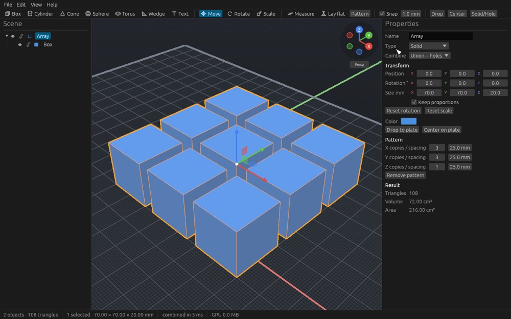
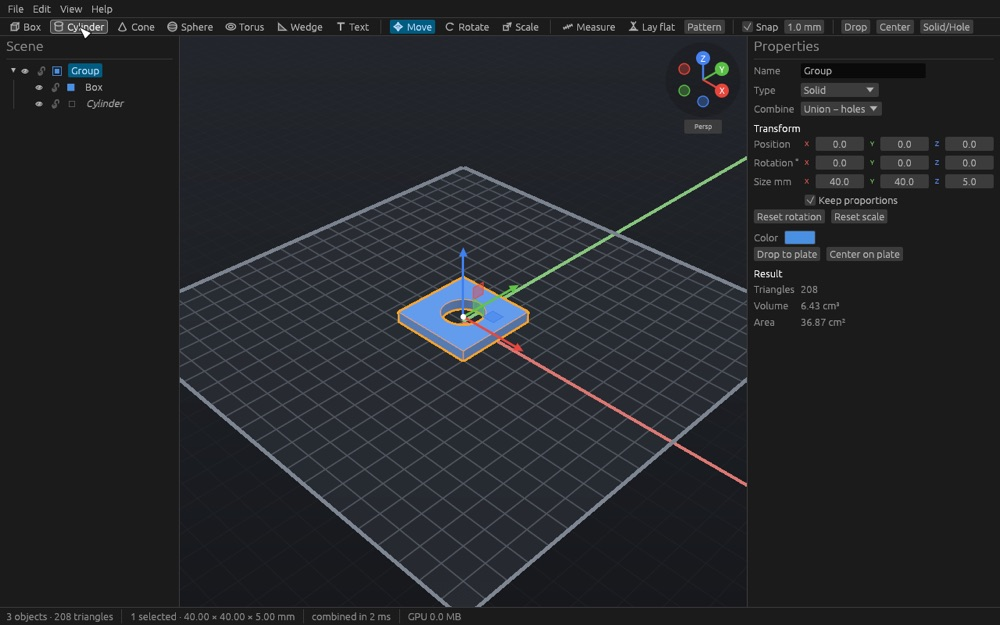
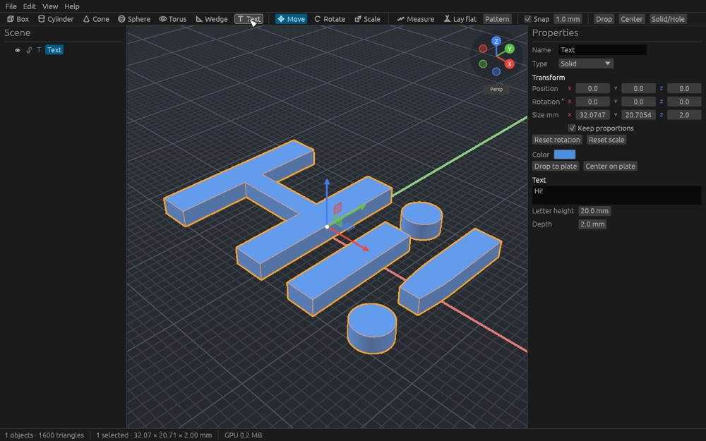
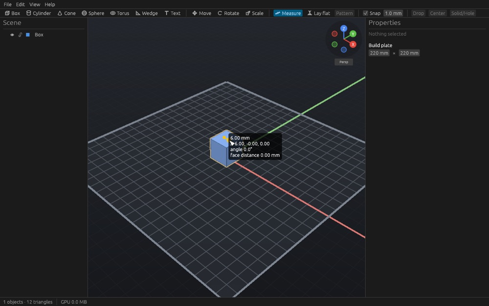
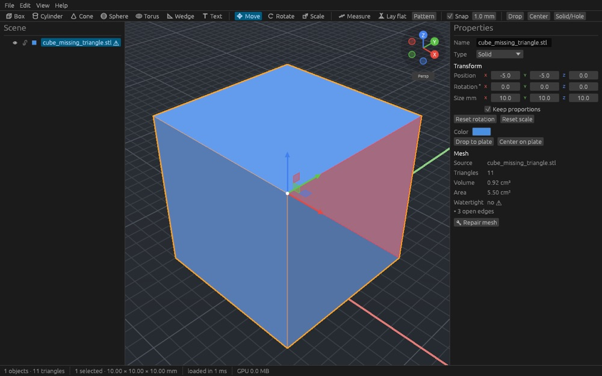

# robocad

A simple, fast and lightweight construction tool for 3D-printable designs.
Combine shapes and imported STL/OBJ files, cut holes, mirror and repeat parts, add text,
repair broken meshes, and export watertight STL or 3MF files for your slicer.



## Features
- **Shapes**: box, cylinder, cone, sphere, torus, wedge and 3D text, all with exact sizes in mm.
- **Holes and groups**: any object can be a *hole*; grouping (⌘G) unions the solids and cuts the holes. Groups can intersect instead.
- **Patterns**: mirror, linear/grid arrays and circular arrays that stay editable.
- **Extensions** (off by default, enable in Preferences → Extensions): **Round edges** rounds all outward edges of the selected object with an editable radius.
- **Direct manipulation**: drag objects on the plate, move/rotate/scale handles with snapping, typed values with arithmetic (`20/2+3`), align, drop to plate, lay a face flat, measure distances and wall thickness.
- **Import**: STL (binary and ASCII) and OBJ, with automatic safe fixes; one-click **Repair** for open, inside-out or non-manifold meshes.
- **Export**: watertight STL, or 3MF with one object per part and colours. Checked with PrusaSlicer.
- **Projects**: `.rcad` files with undo history in the session, autosave and crash recovery.
- **Fast and light**: starts in well under a second, idles at 0 % CPU, renders millions of triangles smoothly, booleans of 100k-triangle meshes in ~25 ms.

| | |
|---|---|
|  |  |
|  |  |

## Quick start (5 minutes)
1. Download the package for your system from the [releases](../../releases) page, or build it (below).
2. Start robocad and drop an STL file onto the window (or **File > Import**, ⌘I). It lands on the plate.
3. Click **Cylinder** in the toolbar, size it in **Properties**, drag it over your part, press **H** to make it a hole.
4. Select both (⌘A) and press **⌘G**: the hole is cut.
5. **File > Export STL…** and open the file in your slicer. Save the project with ⌘S.

Mouse: right-drag orbits, middle-drag (or Shift + right) pans, the wheel zooms to the cursor.
Trackpad: two-finger drag orbits, Shift + two fingers pans, pinch zooms. Press **F1** for all shortcuts.
Other mouse layouts (Blender, Fusion 360) are in **Preferences** (⌘,). On Windows and Linux use Ctrl instead of ⌘.

## Command line
```sh
robocad-cli info part.stl              # size, volume, watertightness, problems
robocad-cli repair broken.stl fixed.stl
robocad-cli convert part.stl part-ascii.stl --ascii
robocad-cli info project.rcad          # object tree
robocad-cli export project.rcad out.stl
```

## Building
Requirements: a stable Rust toolchain (1.90+), CMake, a C++17 compiler and `git`
(the geometry kernel [Manifold](https://github.com/elalish/manifold) is built from source on the first build, which takes a few minutes).
On Linux you also need the usual windowing development packages (see `.github/workflows/ci.yml`).

```sh
cargo run --release -p rc-app             # desktop app
cargo run --release -p rc-cli -- --help   # command-line tool
./build.sh                                # macOS: robocad.app + DMG, and Windows robocad.exe + zip, in dist/
./build.sh mac                            # only the macOS app (add --universal for Intel + Apple Silicon)
./build.sh windows                        # only robocad.exe, cross-compiled with mingw-w64
```

The Windows build from macOS or Linux needs CMake 3.21+ and mingw-w64 (`brew install mingw-w64` or
`sudo apt install mingw-w64`); the executables link everything statically and need no extra DLLs.

Development: see [CLAUDE.md](CLAUDE.md) for conventions and the full check, [PLAN.md](PLAN.md) for the design,
[docs/performance.md](docs/performance.md) for measurements and [docs/release.md](docs/release.md) for releasing.

## Troubleshooting

**`fatal error: 'cstdint' file not found` on macOS**: the Command Line Tools install contains a
stale C++ header directory. Either reinstall them (`sudo rm -rf /Library/Developer/CommandLineTools && xcode-select --install`)
or point the compiler at the SDK headers for the build:

```sh
export CXXFLAGS="-isystem $(xcrun --show-sdk-path)/usr/include/c++/v1"
cargo clean -p manifold-csg-sys   # only if a failed build was cached
cargo build --release
```

## License
Licensed under either of [Apache License 2.0](LICENSE-APACHE) or [MIT license](LICENSE-MIT) at your option.
The bundled Lato font is licensed under the [SIL Open Font License](assets/fonts/OFL.txt).
